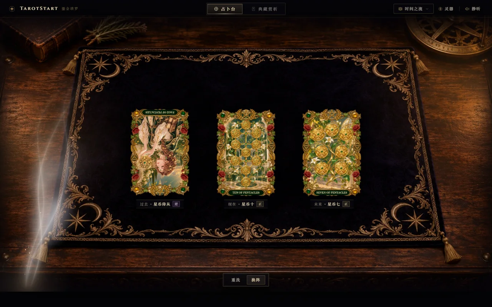
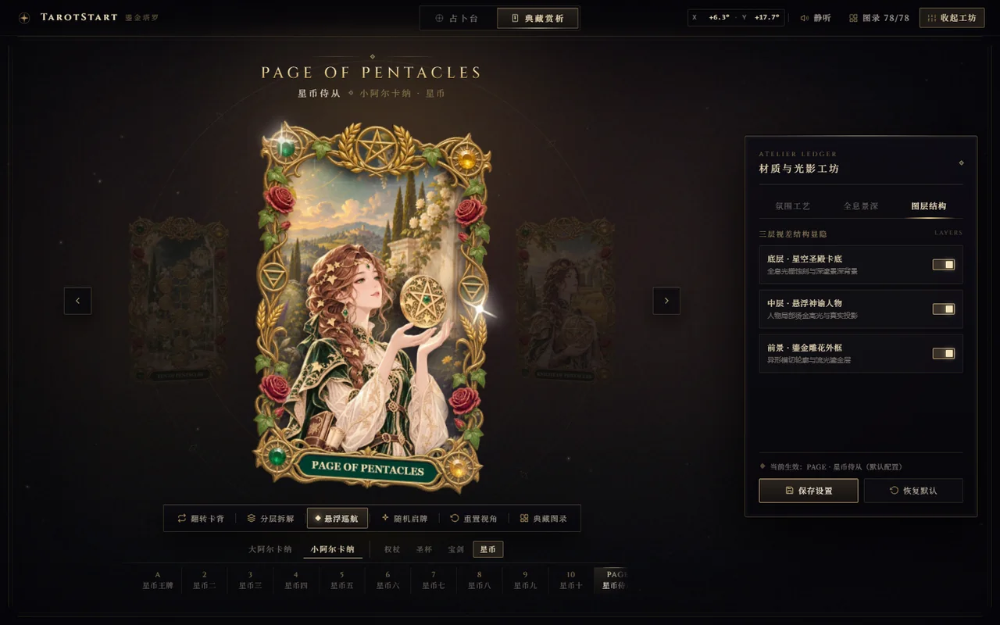
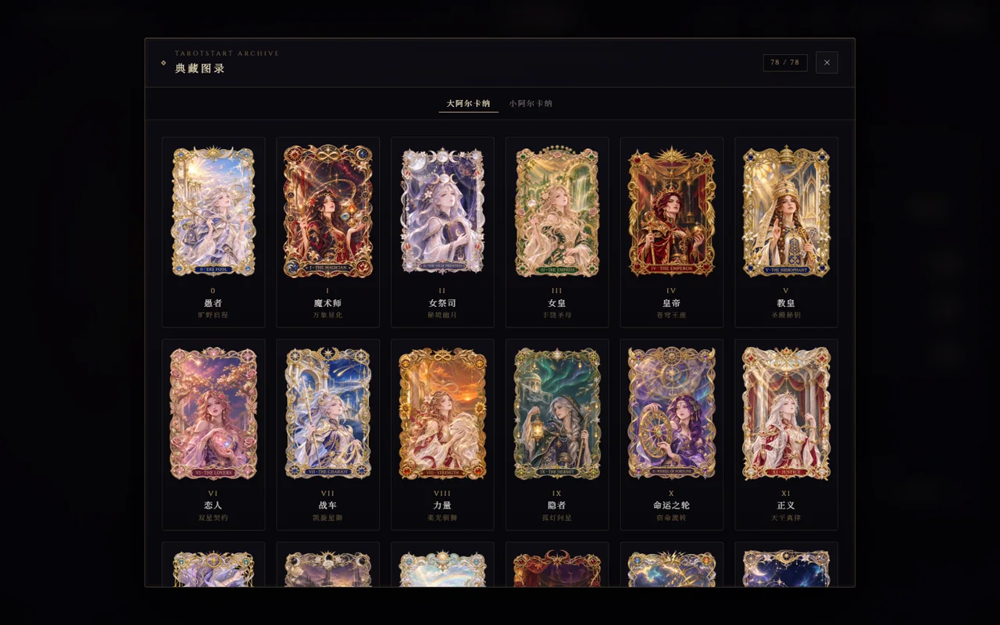

<div align="center">

# ✦ TarotStart

**典藏鎏金塔罗 · 沉浸式线上占卜台与 3D 全息赏析展厅**

[](https://xuxinxi14.github.io/TarotStart/)
[-2a2433?style=for-the-badge)](https://xuxinxi14.github.io/TarotStart/)
[](https://xuxinxi14.github.io/TarotStart/)

[**在线体验 TarotStart ↗**](https://xuxinxi14.github.io/TarotStart/)

</div>

---

## 展厅预览

<p align="center">
  
</p>

<p align="center">
  
  
</p>

---

## 核心特色

### 1. 全套 78 张三图层立体鎏金塔罗牌
- **完整伟特体系**：收录 22 张大阿尔卡纳（Major Arcana）与 56 张小阿尔卡纳（权杖、圣杯、宝剑、星币，含 16 张宫廷牌）。
- **三图层物理视差**：每张牌均由 `bg`（底层星空秘境）、`subject`（中层悬浮主体 + 局部烫金高光遮罩）、`frame`（前景鎏金雕花异形模切边框）独立合成，随指针倾角产生立体景深偏移。
- **全息 SAR 烫金光学**：支持切换复古鎏金、玫瑰鎏金、冷冽秘银等金属质感，可实时调节全息虹彩光栅、流沙星尘粒子、景深系数与分层拆解视图。

### 2. 沉浸式古典圣殿占卜台
- **8 种经典牌阵**：
  - `单卡指引`（1 张）· `时间之流`（3 张）· `圣三角牌阵`（3 张）· `二择一牌阵`（5 张）
  - `关系之镜`（5 张）· `六芒星牌阵`（7 张）· `维纳斯之爱`（8 张）· `凯尔特十字`（10 张）
- **完整抽牌仪式**：支持「揉洗 / 交错洗牌 / 三叠切牌 / 弧形展扇择牌 / 逐张或一键揭牌」，可选完整 78 牌 / 大阿卡纳 / 小阿卡纳范围及是否包含逆位。
- **复杂牌阵全绒布镜头**：面对 5 张及以上的复杂牌阵时，自动推近并延展黑曜绒布视域，支持悬停局部放大、`100%–240%` 滚轮/按钮缩放与画布拖拽漫游，并可随时点击任意已翻开的牌切入 **3D 典藏光箱** 细赏。

### 3. 去实体化光氛与互动灵器匣
- **圣殿光氛**：左右暖金烛火呼吸光晕与**圣木轻烟**（多股丝绒状上升烟丝与金尘微粒），可独立开关。
- **灵器匣（`灵器` 面板）**：内置胡桃木桌 / 黑曜鎏金绒布双桌面切换、颂钵声波共鸣、占星灵摆与占星骰子等氛围交互，配合纯前端 Web Audio API 合成的仪式音效。

### 4. 纯静态展示版本说明
- 本项目面向 **GitHub Pages** 纯静态托管优化，**零后端、零构建依赖**。
- 已移除本地图片上传、三图层自定义替换工坊及本地 JSON 备份导入/导出等非静态能力，专注提供纯粹的**抽牌占卜**与 **78 张卡牌 3D 赏析**体验。

---

## 本地运行

项目为纯静态 HTML / CSS / JavaScript 应用，无需打包或安装依赖：

```bash
# 方式一：使用 Python 内置静态服务器（推荐）
python -m http.server 8080

# 方式二：使用 Node.js serve
npx serve .
```

启动后在浏览器访问 `http://localhost:8080/` 即可体验（也可直接双击打开 `index.html`）。

---

## 目录结构

```text
TarotStart/
├── index.html                  # 主入口：占卜台、3D 典藏赏析展厅与 78 张典藏图录
├── 3d.html                     # 兼容旧入口的轻量重定向至 index.html
├── .nojekyll                   # GitHub Pages 纯静态资源直出标识
├── docs/                       # README 展示截图
└── assets/
    ├── card-back.webp          # 黑曜鎏金圣徽牌背
    ├── arcana/                 # 全套 78 张卡牌三图层 WebP 与元数据脚本 (cards.js / minor-cards.js)
    ├── altar/                  # 3D 圣殿祭坛背景与星盘光轮特效
    └── divination/             # 占卜台引擎、牌阵配置、圣木烟雾与光氛系统、Web Audio 仪式音效
```

---

<div align="center">
  <sub>TarotStart · Crafted for quiet contemplation and luminous 3D tarot appreciation.</sub>
</div>
